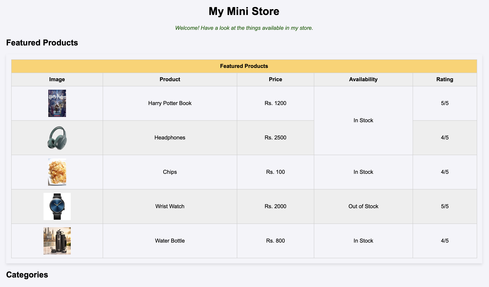
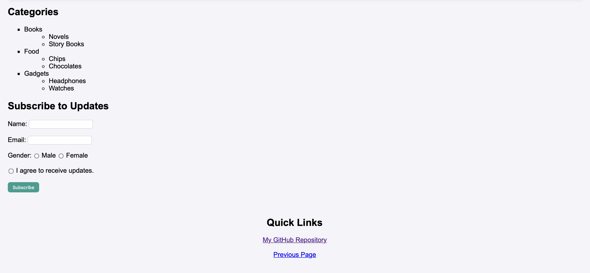

# My Mini Store
## About My Store
I made this mini store as part of my ICT assignment.
It contains five products with their pictures, prices, ratings and availability.
## CSS Precedence
**1. What color is the tagline?**
The tagline is green because I used inline CSS for it.
**2. What color are the other paragraphs?**
The other paragraphs are dark red because I used internal CSS.
**3. Why?**
Inline CSS has the highest priority.
Internal CSS has more priority than external CSS because it comes later.
So, the order is inline > internal > external.
## Screenshot

